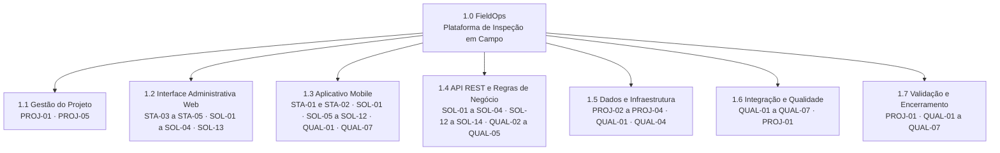

# Atividade 03 — Estrutura Analítica do Projeto (EAP)

## FieldOps — Plataforma de Inspeção em Campo

## Objetivo

Elaborar a Estrutura Analítica do Projeto (EAP) do FieldOps, decompondo hierarquicamente o escopo total do trabalho em entregas e pacotes de trabalho menores e gerenciáveis. O diagrama também relaciona os principais requisitos do projeto por meio de códigos.

## Diagrama da EAP

## Detalhamento dos pacotes de trabalho

### 1.1 Gestão do Projeto

- 1.1.1 Termo de Abertura do Projeto
- 1.1.2 Definição e controle do escopo
- 1.1.3 Estrutura Analítica do Projeto (EAP)
- 1.1.4 Backlog e roadmap
- 1.1.5 Gestão de riscos
- 1.1.6 Gestão de mudanças
- 1.1.7 Acompanhamento e documentação do projeto

### 1.2 Interface Administrativa Web

- 1.2.1 Autenticação e controle de acesso
- 1.2.2 Gestão de usuários e perfis
- 1.2.3 Cadastro de clientes, locais e equipamentos
- 1.2.4 Modelos de inspeção e versionamento
- 1.2.5 Agendamento e atribuição de inspeções
- 1.2.6 Acompanhamento de inspeções e status
- 1.2.7 Visualização de respostas e evidências
- 1.2.8 Gestão de não conformidades
- 1.2.9 Revisão, aprovação e reprovação
- 1.2.10 Indicadores de supervisão

### 1.3 Aplicativo Mobile

- 1.3.1 Autenticação e gerenciamento de sessão
- 1.3.2 Consulta das inspeções atribuídas
- 1.3.3 Detalhamento e início da inspeção
- 1.3.4 Execução de checklists dinâmicos
- 1.3.5 Identificação de equipamento por QR Code
- 1.3.6 Registro de fotografias e evidências
- 1.3.7 Registro de observações e não conformidades
- 1.3.8 Captura de localização
- 1.3.9 Persistência local dos dados
- 1.3.10 Funcionamento offline
- 1.3.11 Sincronização e status de sincronização

### 1.4 API REST e Regras de Negócio

- 1.4.1 Autenticação
- 1.4.2 Autorização por perfil
- 1.4.3 Gestão dos dados administrativos
- 1.4.4 Gestão dos modelos de inspeção
- 1.4.5 Gestão do ciclo de vida das inspeções
- 1.4.6 Validações e regras de negócio
- 1.4.7 Upload e consulta de evidências
- 1.4.8 Sincronização de dados
- 1.4.9 Idempotência e prevenção de duplicidades
- 1.4.10 Histórico e auditoria
- 1.4.11 Tratamento padronizado de erros
- 1.4.12 Documentação da API

### 1.5 Dados e Infraestrutura

- 1.5.1 Modelo e persistência dos dados centrais
- 1.5.2 Banco de dados PostgreSQL
- 1.5.3 Persistência local em SQLite
- 1.5.4 Armazenamento das evidências
- 1.5.5 Configuração dos ambientes
- 1.5.6 Logs e registros de auditoria

### 1.6 Integração e Qualidade

- 1.6.1 Integração Web ↔ API
- 1.6.2 Integração Mobile ↔ API
- 1.6.3 Testes das regras de negócio
- 1.6.4 Testes de autenticação e autorização
- 1.6.5 Testes de funcionamento offline
- 1.6.6 Testes de sincronização
- 1.6.7 Testes de idempotência e duplicidade
- 1.6.8 Testes de evidências e permissões do dispositivo
- 1.6.9 Validação dos critérios de aceitação

### 1.7 Validação e Encerramento

- 1.7.1 Validação do fluxo completo do MVP
- 1.7.2 Validação das entregas
- 1.7.3 Documentação final
- 1.7.4 Demonstração da solução
- 1.7.5 Registro dos resultados e encerramento

## Requisitos associados

| Código | Classificação | Requisito |
|---|---|---|
| NEG-01 | Necessidade de negócio | Digitalizar o processo de inspeções e reduzir a dependência de formulários impressos, planilhas e registros informais. |
| NEG-02 | Necessidade de negócio | Padronizar a execução das inspeções por meio de modelos e checklists. |
| NEG-03 | Necessidade de negócio | Preservar a rastreabilidade das informações, evidências, responsáveis e alterações. |
| NEG-04 | Necessidade de negócio | Reduzir o intervalo entre a execução em campo e a disponibilidade dos resultados. |
| NEG-05 | Necessidade de negócio | Facilitar a identificação e o acompanhamento de não conformidades. |
| STA-01 | Parte interessada | O técnico deve conseguir consultar e executar suas inspeções pelo aplicativo mobile. |
| STA-02 | Parte interessada | O técnico deve conseguir continuar o trabalho mesmo sem conexão temporária com a internet. |
| STA-03 | Parte interessada | O supervisor deve conseguir planejar, atribuir e acompanhar inspeções. |
| STA-04 | Parte interessada | O supervisor deve conseguir revisar os resultados e aprovar, reprovar ou solicitar correções. |
| STA-05 | Parte interessada | O administrador deve conseguir manter usuários, clientes, locais e equipamentos pela interface web. |
| SOL-01 | Solução | Autenticação e autorização por perfil. |
| SOL-02 | Solução | Cadastro de clientes, locais, equipamentos e usuários. |
| SOL-03 | Solução | Criação e versionamento de modelos de inspeção. |
| SOL-04 | Solução | Agendamento e atribuição de inspeções. |
| SOL-05 | Solução | Checklists dinâmicos. |
| SOL-06 | Solução | Identificação de equipamentos por QR Code. |
| SOL-07 | Solução | Captura de fotografias e evidências. |
| SOL-08 | Solução | Registro de localização mediante autorização. |
| SOL-09 | Solução | Registro de observações e não conformidades. |
| SOL-10 | Solução | Persistência local no dispositivo. |
| SOL-11 | Solução | Funcionamento offline. |
| SOL-12 | Solução | Sincronização com o servidor. |
| SOL-13 | Solução | Revisão, aprovação, reprovação e solicitação de correção. |
| SOL-14 | Solução | Histórico e auditoria. |
| PROJ-01 | Projeto | O MVP deve contemplar o fluxo principal completo da inspeção, do planejamento à revisão. |
| PROJ-02 | Projeto | Android é a plataforma prioritária e obrigatória para validação mobile. |
| PROJ-03 | Projeto | A solução deve utilizar a arquitetura e as tecnologias definidas para o projeto. |
| PROJ-04 | Projeto | A comunicação entre os componentes deve ocorrer por API REST. |
| PROJ-05 | Projeto | O escopo do MVP deve ser preservado para evitar que funcionalidades fora do escopo comprometam a entrega. |
| QUAL-01 | Qualidade | Dados ainda não sincronizados devem ser preservados, inclusive após o fechamento do aplicativo. |
| QUAL-02 | Qualidade | O reenvio da mesma operação não deve gerar registros duplicados. |
| QUAL-03 | Qualidade | Usuários devem acessar apenas operações permitidas ao seu perfil. |
| QUAL-04 | Qualidade | Os dados devem permanecer consistentes entre mobile, web, API e banco de dados. |
| QUAL-05 | Qualidade | Operações relevantes devem possuir histórico e auditoria. |
| QUAL-06 | Qualidade | Uma inspeção aprovada deve ficar protegida contra alterações comuns. |
| QUAL-07 | Qualidade | Uma inspeção previamente disponibilizada deve poder ser executada sem conexão. |

## Observação sobre requisitos de transição

A documentação atual do FieldOps não define formalmente migração de dados legados nem treinamento obrigatório dos usuários. Por isso, não foram criados requisitos de transição artificiais apenas para preencher a classificação.

## Entrega

Este arquivo e o PDF `EAP-FieldOps.pdf` devem ser adicionados ao repositório do GitHub na pasta da Atividade 03.
