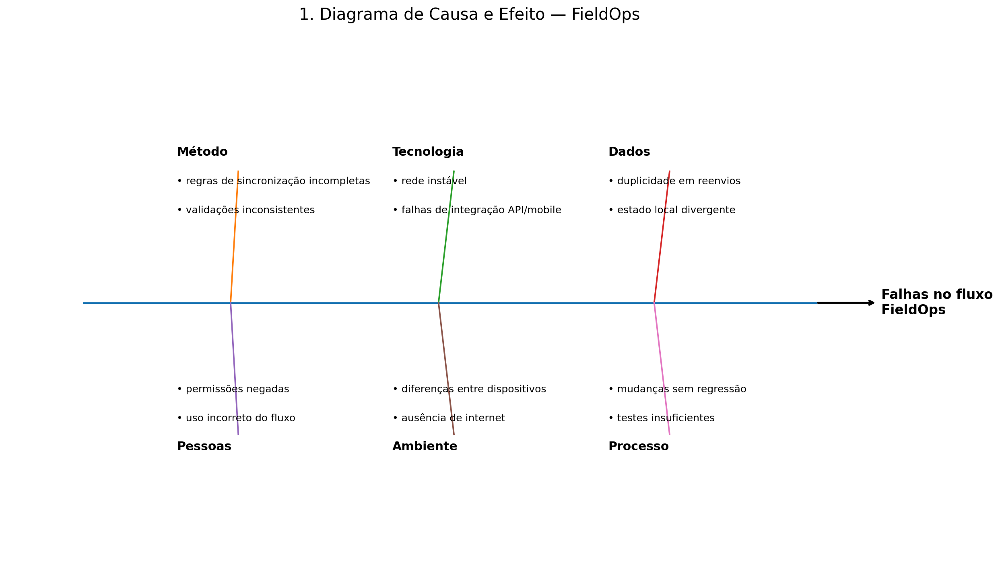
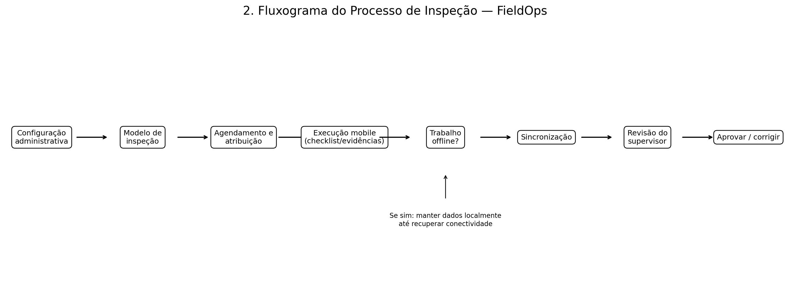
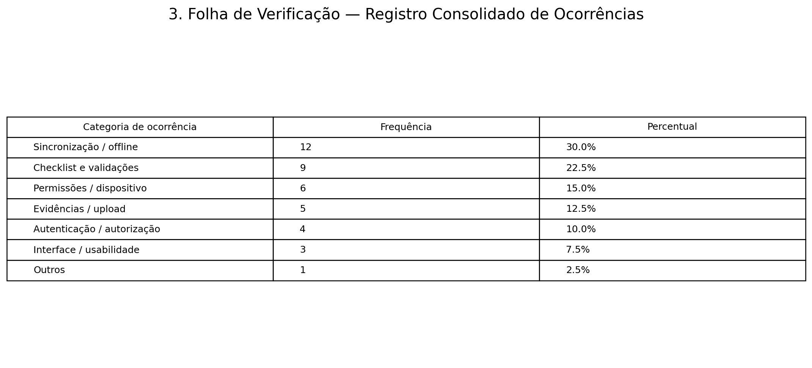
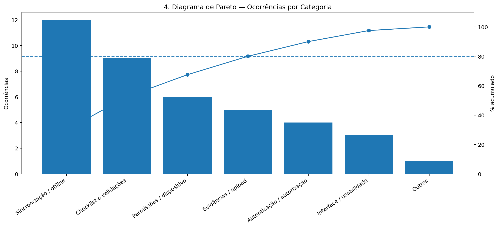
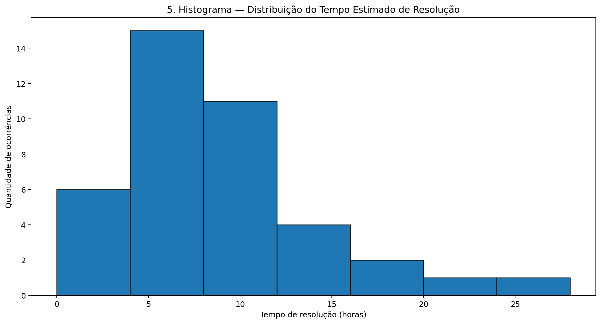
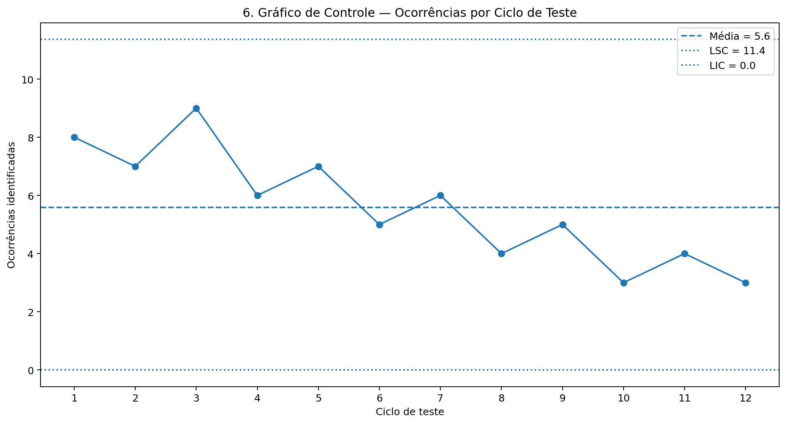
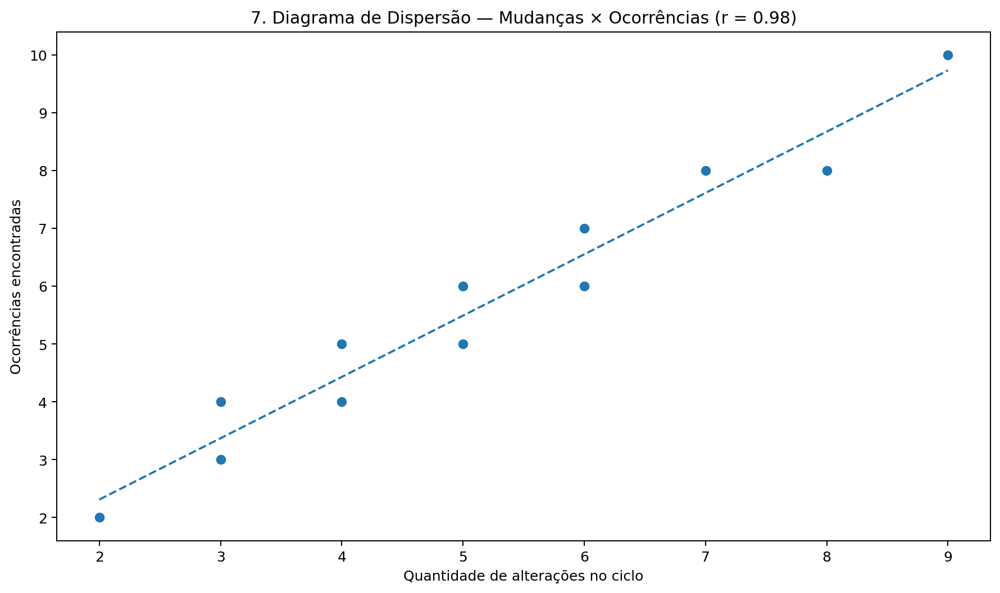

# Atividade 05 — Análise da Qualidade do Projeto FieldOps

## Objetivo

Aplicar as **Sete Ferramentas de Qualidade Básicas** ao contexto do **FieldOps — Plataforma de Inspeção em Campo**, utilizando a documentação e os artefatos do projeto para identificar pontos críticos, organizar evidências de qualidade e apoiar ações de prevenção e melhoria.

## Nota sobre os dados

A documentação disponível do FieldOps define requisitos, critérios de aceitação, riscos e fluxos do produto, porém não apresenta um histórico quantitativo real de defeitos de produção.

Por esse motivo, os dados numéricos utilizados nesta atividade representam um **cenário acadêmico de análise**, criado exclusivamente para demonstrar a aplicação das sete ferramentas de qualidade. Eles **não devem ser interpretados como métricas reais do FieldOps**.

O cenário considera **40 ocorrências de referência**, distribuídas conforme os principais pontos de atenção do projeto: sincronização/offline, checklist e validações, permissões do dispositivo, evidências, autenticação/autorização e usabilidade.

---

## 1. Diagrama de Causa e Efeito



### Aplicação

O problema central analisado foi **“falhas no fluxo do FieldOps”**, principalmente aquelas capazes de comprometer a execução, preservação e sincronização de uma inspeção.

As causas foram organizadas em seis grupos:

- **Método:** regras incompletas de sincronização e validações inconsistentes;
- **Tecnologia:** rede instável e falhas de integração entre API e aplicativo;
- **Dados:** duplicidade em reenvios e divergência entre estado local e servidor;
- **Pessoas:** utilização incorreta do fluxo e permissões negadas;
- **Ambiente:** ausência de internet e diferenças entre dispositivos;
- **Processo:** cobertura de testes insuficiente e alterações sem regressão.

### Análise

A ferramenta mostra que problemas de qualidade não têm uma única origem. No FieldOps, uma falha percebida pelo técnico pode resultar tanto de conectividade quanto de regra de negócio, persistência local, permissão do aparelho ou processo de desenvolvimento.

### Conclusão

A prevenção deve combinar validações técnicas, testes de integração, testes offline, controle de mudanças e mensagens claras ao usuário.

---

## 2. Fluxograma



### Aplicação

O fluxograma representa o ciclo principal do FieldOps:

**configuração administrativa → modelo de inspeção → agendamento e atribuição → execução mobile → operação offline quando necessário → sincronização → revisão do supervisor → aprovação ou correção.**

### Análise

O fluxo evidencia dois pontos especialmente críticos para a qualidade:

1. a transição entre execução local e sincronização;
2. a passagem do resultado executado para a revisão do supervisor.

### Conclusão

Essas transições devem possuir critérios de aceitação claros e testes de integração específicos, pois qualquer falha nelas compromete o fluxo ponta a ponta.

---

## 3. Folha de Verificação



### Dados

| Categoria | Ocorrências | Percentual |
|---|---:|---:|
| Sincronização / offline | 12 | 30.0% |
| Checklist e validações | 9 | 22.5% |
| Permissões / dispositivo | 6 | 15.0% |
| Evidências / upload | 5 | 12.5% |
| Autenticação / autorização | 4 | 10.0% |
| Interface / usabilidade | 3 | 7.5% |
| Outros | 1 | 2.5% |

### Análise

A folha de verificação organiza as ocorrências por categoria e permite identificar onde existe maior concentração de problemas.

No cenário analisado, **sincronização/offline** e **checklist/validações** representam juntas **52.5%** das ocorrências.

### Conclusão

O registro padronizado das falhas deve ser mantido durante os ciclos de teste para permitir comparação entre versões e acompanhamento da evolução da qualidade.

---

## 4. Diagrama de Pareto



### Análise

O Pareto foi elaborado a partir da mesma folha de verificação.

As categorias com maior frequência são:

1. sincronização/offline;
2. checklist e validações;
3. permissões/dispositivo;
4. evidências/upload.

Essas quatro categorias representam **80.0%** do total analisado.

### Conclusão

O resultado indica que uma estratégia de qualidade deve priorizar primeiro os problemas relacionados ao funcionamento em campo, integridade do checklist, recursos do dispositivo e evidências. Resolver essas categorias tende a produzir o maior impacto sobre a confiabilidade do MVP.

---

## 5. Histograma



### Aplicação

O histograma apresenta a distribuição do **tempo estimado de resolução das ocorrências**, medido em horas.

### Análise

A maior parte das ocorrências permanece nas faixas de menor e média duração, enquanto problemas de sincronização apresentam alguns dos maiores tempos de resolução.

Isso é coerente com a complexidade dessa área, pois ela envolve aplicativo, armazenamento local, conectividade, API e persistência central.

### Conclusão

Problemas de sincronização devem receber margem maior de análise e teste no planejamento, pois tendem a demandar investigação entre diferentes componentes da solução.

---

## 6. Gráfico de Controle



### Aplicação

Foi utilizado um conjunto de **12 ciclos de teste** para representar a quantidade de ocorrências encontradas ao longo da evolução do produto.

### Análise

Os valores apresentam tendência de redução, saindo de níveis próximos a 8–9 ocorrências para aproximadamente 3–4 nos ciclos finais.

Nenhum ponto ultrapassa os limites calculados no cenário de referência.

### Conclusão

O comportamento sugere estabilização e melhoria do processo. Em uma aplicação real, novos pontos fora dos limites ou uma mudança persistente de tendência deveriam provocar investigação antes da liberação da versão.

---

## 7. Diagrama de Dispersão



### Aplicação

O diagrama compara:

- número de alterações realizadas em cada ciclo;
- número de ocorrências identificadas após essas alterações.

A correlação do cenário é aproximadamente **0.98**.

### Análise

Existe uma relação positiva entre quantidade de mudanças e quantidade de ocorrências encontradas. Quanto maior a quantidade de alterações realizadas em um ciclo, maior tende a ser a quantidade de problemas identificados nos testes.

### Conclusão

O resultado reforça a necessidade de executar **testes de regressão** sempre que houver alterações significativas no sistema, principalmente quando várias funcionalidades forem modificadas simultaneamente.

---

# Conclusão Geral

A aplicação das sete ferramentas mostra que a qualidade do FieldOps deve ser tratada de forma preventiva e mensurável.

A análise indica como pontos prioritários:

- funcionamento offline;
- sincronização confiável;
- prevenção de duplicidade;
- validação dos itens obrigatórios do checklist;
- registro consistente de evidências;
- autenticação e autorização por perfil;
- testes de regressão após alterações relevantes.

O objetivo não é apenas localizar defeitos depois que eles acontecem. A gestão da qualidade deve ajudar a **prevenir falhas, acompanhar resultados e melhorar continuamente o processo**, mantendo o fluxo principal do FieldOps confiável desde o planejamento da inspeção até sua revisão final.

## Estrutura dos arquivos

```text
Atividade 05 - Qualidade/
├── README.md
├── dados-qualidade.csv
└── figuras/
    ├── 01-causa-efeito.png
    ├── 02-fluxograma.png
    ├── 03-folha-verificacao.png
    ├── 04-pareto.png
    ├── 05-histograma.png
    ├── 06-grafico-controle.png
    └── 07-dispersao.png
```
